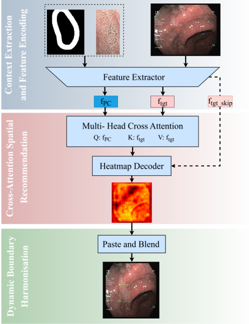

# CAMP

CAMP is an image-augmentation framework. It copies an instance from a source image, chooses where that instance belongs on a target image, and blends it in. The pipeline has three steps, top to bottom in the figure.

1. **Segmentor.** Context extraction and feature encoding. The ring around the instance and the target image go through one shared feature extractor.
2. **Recommender.** Cross-attention spatial recommendation. Multi-head cross-attention reads that context against the target, and a decoder turns the result into a placement heatmap.
3. **Generate.** Paste and blend. The instance is inserted at the chosen box, and the boundary is harmonised.



Step 3 builds a closed-form alpha matte, restores the unmultiplied foreground, transfers colour locally in CIELAB (Reinhard, luminance weight 0.72), and composites the frequencies with a 4-level Laplacian pyramid. The blend notes are in [`camp/blend/README.md`](camp/blend/README.md).

CAMP is used for natural images and for medical images. Clinical datasets are not included in this repository. You bring your own images and masks.

The public entry point is `CAMP` in the `camp` package.

## Setup

From the repository root, create the virtual environment once with [`environment.yml`](environment.yml). This is the only install file. It is the same on Windows, Linux, and macOS, and the environment is named `CAMP`. Conda installs the PyTorch build for that machine: CUDA 12.4 on Windows and on 64-bit Linux, and the CPU or MPS build on macOS and on Linux ARM.

```bash
conda env create -f environment.yml
conda activate CAMP
pip install -e .
```

`pip install -e .` is run inside that conda environment. It does not replace the PyTorch build conda installed. After `pip install -e .`, `python -m camp` and `camp` are the commands. `python -m camp` is the form to copy. `camp` works when the CAMP environment is active. If `pyproject.toml` just changed, run `pip install -e .` again so the `camp` command appears.

Training and generation use the GPU when you pass nothing (`--device cuda`). If CUDA was requested and this machine has no CUDA device, CAMP uses the CPU. On a machine without an NVIDIA GPU you can pass `--device cpu`. On Apple silicon you can pass `--device mps`.

Albumentations stays on 1.3.1 because the dataset calls `GaussNoise(var_limit=...)`, which 2.x removed. NumPy stays below 2, and OpenCV stays below 4.10, so the same file resolves on a new machine.

### Check the install

These commands train each stage for one or two epochs and write two augmented images. They check that the environment and the data layout work. They do not replace the training runs below. One epoch walks every paired image: there is no flag to take a subset.

```bash
python -m camp train segmentor --class <class> --epochs 2 --freeze-epochs 1 --batch-size 2 --accumulation-steps 1 --image-size 256 --patience 5
python -m camp train recommender --class <class> --epochs 1 --finetune-epochs 1 --batch-size 1 --accumulation-steps 1 --image-size 256 --patience 5
python -m camp generate --class <class> --num 2 --max-source 4 --seed 42
```

## Data layout

Bring one class under `data/`. The folder name is the value you pass to `--class`. `--data-dir` defaults to `data` and has to be a folder named `data`. CAMP's project root is the parent of that folder. A relative `--data-dir` is resolved from the repository root. Training reads pairs of RGB images and grayscale masks from that class. A mask shares the image stem, with `.jpg` or `.jpeg` replaced by `.png`. Pairs whose mask is missing are skipped. `data/` and `weights/` are gitignored.

The tree below is the shape the trainers and `generate` look for. `<class>` is the folder name you pass to `--class`. `frame_001.jpg` is only there to show that it pairs with `frame_001.png`.

```
.
├── data/
│   ├── <class>/
│   │   ├── <class>/
│   │   │   ├── images/
│   │   │   │   ├── frame_001.jpg
│   │   │   │   └── frame_002.png
│   │   │   └── masks/
│   │   │       ├── frame_001.png
│   │   │       └── frame_002.png
│   │   └── normal/
│   │       └── images/
│   │           └── bg_001.jpg
│   └── augmented/
│       └── <class>/
│           ├── images/
│           │   └── aug_0000.png
│           └── masks/
│               └── aug_0000.png
└── weights/
    └── <class>/
        ├── segmentor/
        │   └── best.pth
        └── recommender/
            └── best.pth
```

`<class>/<class>` is the source: the images the instance is copied from, with masks beside them. `<class>/normal` is optional: the backgrounds the instance is pasted onto. Training writes `weights/`. Generation writes `data/augmented/`.

The same class can sit one level higher, with no nested folder of the same name. Backgrounds can sit in `normal/` itself when that folder has no `images/` inside it.

```
data/
└── <class>/
    ├── images/
    ├── masks/
    └── normal/
        └── images/
```

The trainers resolve the paired folder in this order:

1. `data/<class>/<class>/images`, with masks in the sibling `masks/`
2. `data/<class>/images`, with masks in the sibling `masks/`

Train and val are disjoint. `PairedMaskDataset` shuffles paired files with seed 42, cuts at `split_ratio` (default 0.2), and gives the head to train and the tail to val. Together the two splits cover every paired file. The same cut is used for the segmentor and the recommender.

Generation uses two folders:

- **Source** (where the instance is copied from): `data/<class>/<class>/` when that folder has `images/`, otherwise `data/<class>/`.
- **Target** (where it is pasted): `data/<class>/normal/` when that directory exists, otherwise the same folder as the source.

`--source-dir` and `--target-dir` override those defaults. If a directory has no images at the top level, the loader also looks in `<dir>/images`. Masks are read from a sibling `masks/` folder.

Default training resolution is 512×512. Patches are 128×128.

On the command line the flag uses hyphens (`--batch-size`). In Python the same setting is the keyword with underscores (`batch_size`). `--class` and `--class-name` are both `class_name`.

## 1. Segmentor

This step is the context extraction and feature encoding in the figure. Train it before the recommender. The recommender freezes it and uses the encoder as its backbone.

The network is a UNet++. The encoder starts from ImageNet weights and is trained as a binary segmentation of the instance, with a Tversky focal loss that penalises missed boundary pixels. The first training stage keeps the encoder frozen and trains the decoder for `freeze_epochs`, at `lr`. The second stage unfreezes the encoder until `epochs` is reached, at `finetune_lr`. The checkpoint is `weights/<class>/segmentor/best.pth`, with `config.yaml` beside it.

```bash
python -m camp train segmentor --class <class>
python -m camp train segmentor --class <class> --epochs 100 --batch-size 4 --freeze-epochs 30
```

```python
from camp import CAMP

camp = CAMP(root=".", device="cuda")
camp.train_segmentor("<class>")
camp.train_segmentor("<class>", epochs=100, batch_size=4, freeze_epochs=30)
```

| Argument | Default | Role |
| --- | --- | --- |
| `class_name` | required | folder name under `data/` |
| `epochs` | `80` | total length; the second stage is what remains after the first |
| `freeze_epochs` | `30` | first stage, encoder frozen |
| `lr` | `3e-4` | first stage |
| `finetune_lr` | `1e-4` | second stage |

Other `train_segmentor` arguments: `encoder` `efficientnet-b3`, `decoder_dropout` `0.4`, `image_size` `512`, `patch_size` `128`, `batch_size` `8`, `accumulation_steps` `2`, `patience` `25`, `split_ratio` `0.2`, `p_remove` `0.0`, `output` `weights/<class>/segmentor/`, `device` `cuda`. `p_remove` is the chance of dropping the instance during training. Validation stays at `0`. `--save-viz N` writes N debug figures at the end (`--debug` is `--save-viz 8`). `--data-dir` is the `data` folder; `CAMP(root=)` is its parent.

## 2. Recommender

This step is the cross-attention spatial recommendation in the figure. It needs the segmentor checkpoint. If `segmentor_weights` is omitted, CAMP looks for `weights/<class>/segmentor/best.pth`, then `best_segmentor.pth`. A missing file raises `FileNotFoundError`.

It attends from the source context, the tissue around the instance rather than the instance interior, onto the target image. The output is a placement heatmap. Peaks on tissue that already holds an instance are suppressed, and the remaining peaks become the boxes used in step 3. The first training stage runs for `epochs` at `lr`. The second runs for `finetune_epochs` at `finetune_lr`. `finetune_epochs=0` skips the second stage. The result is `weights/<class>/recommender/best.pth`.

```bash
python -m camp train recommender --class <class>
python -m camp train recommender --class <class> --epochs 60 --finetune-epochs 20 --segmentor-weights weights/<class>/segmentor/best.pth
```

```python
from camp import CAMP

camp = CAMP(root=".", device="cuda")
camp.train_recommender("<class>")
camp.train_recommender(
    "<class>",
    epochs=60,
    finetune_epochs=20,
    segmentor_weights="weights/<class>/segmentor/best.pth",
)
```

| Argument | Default | Role |
| --- | --- | --- |
| `class_name` | required | same folder as the segmentor |
| `epochs` | `60` | first stage |
| `lr` | `3e-4` | first stage |
| `finetune_epochs` | `20` | second stage; `0` skips it |
| `finetune_lr` | `5e-5` | second stage |
| `segmentor_weights` | auto | checkpoint from the previous step |

Other `train_recommender` arguments: `encoder` `efficientnet-b3`, `embedding_dim` `2048`, `num_heads` `16`, `dropout` `0.10`, `image_size` `512`, `patch_size` `128`, `batch_size` `4`, `accumulation_steps` `4`, `patience` `30`, `split_ratio` `0.2`, `p_remove` `0.0`, `output` `weights/<class>/recommender/`, `device` `cuda`. `--save-viz` and `--data-dir` work as they do for the segmentor.

## 3. Generate

This step is the paste and blend at the bottom of the figure. It loads both checkpoints:

- `weights/<class>/segmentor/best.pth` (or `best_segmentor.pth`)
- `weights/<class>/recommender/best.pth` (or `best_model.pt`)

A missing file makes `load` raise `FileNotFoundError`. For each sample, CAMP extracts the instance from the source mask, or from the segmentor when no mask is given. It reads a box from the recommender heatmap and can search scale, rotation, and flip before blending. Images and masks are written to `data/augmented/<class>/images` and `data/augmented/<class>/masks` as `aug_0000.png`, `aug_0001.png`, and so on.

The CLI draws a batch. `use_tto` searches scale, rotation, and flip. It is on for the command unless you pass `--no-tto`. In `generate_batch` it is off unless you pass `use_tto=True`.

```bash
python -m camp generate --class <class> --num 100
python -m camp generate --class <class> --num 50 --no-tto --source-dir data/<class>/<class> --target-dir data/<class>/normal --seed 42
```

```python
from PIL import Image
from camp import CAMP

camp = CAMP(root=".", device="cuda")
camp.load("<class>")

target_images = [Image.open("data/<class>/normal/images/bg_001.jpg").convert("RGB")]
source_images = [Image.open("data/<class>/<class>/images/frame_001.jpg").convert("RGB")]
source_masks = [Image.open("data/<class>/<class>/masks/frame_001.png").convert("L")]

samples = camp.generate_batch(
    target_images,
    source_images,
    masks=source_masks,
    n=100,
    out="data/augmented/<class>",
    use_tto=True,
)
samples = camp.generate_batch(
    target_images,
    source_images,
    masks=source_masks,
    n=50,
    out="data/augmented/<class>",
    use_tto=False,
    seed=42,
)
```

| Argument | Default | Role |
| --- | --- | --- |
| `class_name` | required | weights and folders for this class |
| `n` | `10` | how many images (`--num`) |
| `use_tto` | on in the CLI, off in `generate_batch` | scale, rotation, and flip search |
| `seed` | none | sampling order |
| `out` | `data/augmented/<class>/` | output directory (`--output`) |

Other generate settings: `--encoder` `efficientnet-b3` (passed to `load`), `--source-dir` and `--target-dir` (the data-layout defaults), `--max-source` `50`, `--save-intermediates N` (first N images one by one; `--debug` is `5`), `--device` `cuda`, `--data-dir` `data`. The command leaves `image_size` at `(512, 512)`.

## Python API

`generate` is the one-image call. The batch above is what the CLI runs. `generate` returns a `Sample`: `image` is the blended RGB image, `mask` is the instance mask, `score` is the recommendation score. `source_mask=None` makes the segmentor build the mask. Call `load` before `extract`, `recommend`, `blend`, `generate`, or `generate_batch`.

```python
sample = camp.generate(
    target_images[0],
    source_images[0],
    source_mask=source_masks[0],
    use_tto=True,
)
sample.image.save("aug.png")
sample.mask.save("aug_mask.png")
```

`generate(..., patch_index=0, recommendation_index=0, top_k=5, use_tto=True)`. Inside `generate_batch`, `top_k` is fixed at `3`. `extract` accepts `min_area=200` and `max_patches=10`. `recommend` accepts `top_k` and `use_tto`. None of these have a CLI flag.

`load(class_name, encoder="efficientnet-b3")` rebuilds the recommender with embedding 2048, 16 heads, and dropout 0.3 before reading the checkpoint. Those three are not arguments of `load`. Training defaults are embedding 2048, 16 heads, and dropout 0.10. A run that changed `embedding_dim` or `num_heads` cannot pass those into `load`.

`CAMP(root=".", device="cuda", verbose=True, image_size=(512, 512), core_strength=0.58, edge_strength=0.88, l_weight=0.72)`. `core_strength`, `edge_strength`, and `l_weight` set the blend and have no CLI flag. Training also passes `image_size` into `train_segmentor` and `train_recommender`. Generation leaves it at `(512, 512)`.

## Code map

| Path | Role |
| --- | --- |
| `camp/api.py` | `CAMP`: train, load, extract, recommend, blend, generate |
| `camp/sample.py` | `Sample` returned by `generate` and `generate_batch` |
| `docs/camp-pipeline.png` | Pipeline figure: context extraction, cross-attention, paste and blend |
| `camp/cli/__init__.py` | Command line: train segmentor, train recommender, generate |
| `camp/__main__.py` | `python -m camp` |
| `camp/cli/viz.py` | Debug figures for `--save-viz` |
| `camp/models/` | Segmentor and recommender |
| `camp/blend/` | Matting, color transfer, and pyramid blend |
| `camp/blend/README.md` | Notes on the four blend steps |
| `camp/figures.py` | Figure helpers used by `--save-viz` |
| `camp/attention_dataset.py` | Pairs each image with its mask for training |

## License

CAMP is released under the MIT license. See [`LICENSE`](LICENSE).
